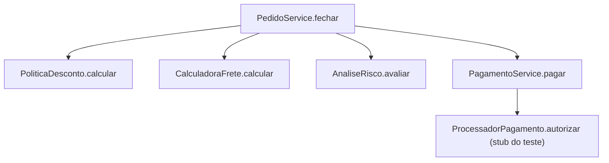
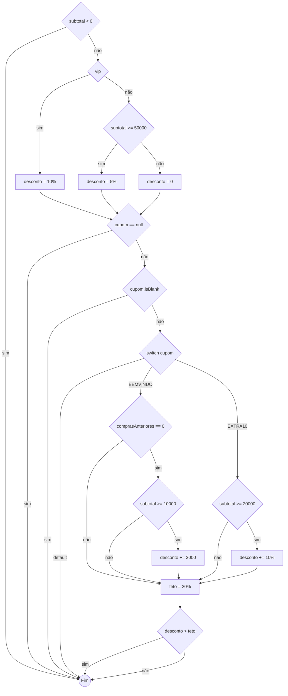
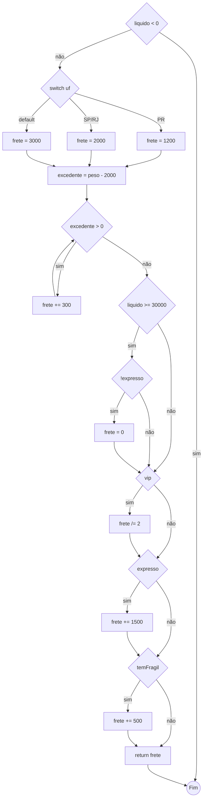
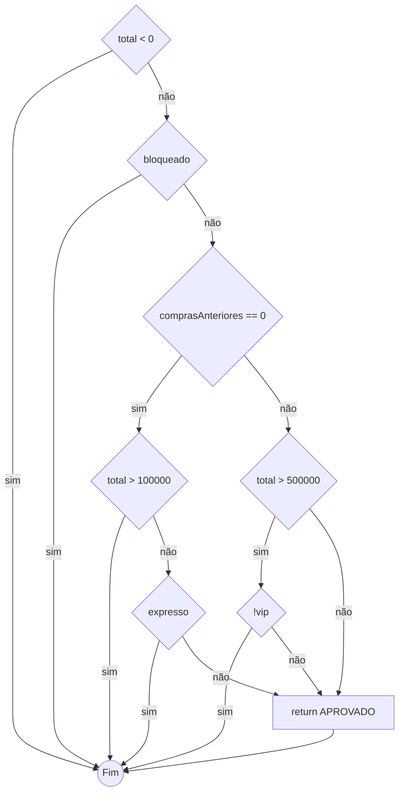
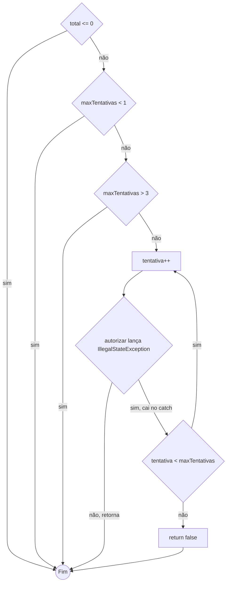
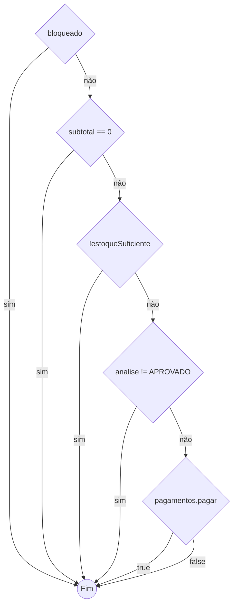

# Relatório do grupo

Integrante: Vinicius Ramon Ferreira

Data: 08/09/2026 (prazo de duas semanas, contando da postagem em 25/08/2026)

## Modelagem adotada

Antes dos grafos, algumas decisões de modelagem que valem pra todos os métodos abaixo:

- Cada operando de um `&&`/`||` é um nó de decisão separado, já que o segundo operando só é avaliado dependendo do primeiro (curto-circuito). Isso aparece bastante em `PoliticaDesconto`, `AnaliseRisco` e no `if` de gratuidade do frete.
- `throw` é tratado como uma aresta pro nó de saída, não como um nó próprio — todo grafo tem saída unificada (um único nó Fim), somando os `return` normais e as exceções.
- Um `switch` conta como decisão pelo número de ramos distintos que ele produz: `n` ramos geram `n − 1` pontos de decisão (o primeiro ramo "sai de graça", os demais são desvios adicionais). Em `CalculadoraFrete`, os `case "SP":` e `case "RJ":` caem no mesmo bloco de código, então contam como um único ramo.
- Um `try`/`catch` em volta de uma chamada que pode lançar é tratado como decisão binária: terminou normal (segue pro retorno) ou caiu no catch (segue pro fluxo de repetição). É o caso do `pagar()`.
- `Objects.requireNonNull` não virou nó de decisão em `PedidoService.fechar` — a ramificação está dentro do código da biblioteca, não no método que estamos analisando.
- Nós que só têm código sequencial (sem desvio) foram fundidos com o nó de decisão seguinte, seguindo a convenção de blocos básicos — reduz nós redundantes sem mudar V(G), porque contrair uma aresta entre dois nós de grau 1 preserva `E − N`.

Contei nós e arestas manualmente pra cada grafo e conferi que `V(G) = E − N + 2` bate com `decisões + 1` nos cinco métodos — deu certo nos cinco, o que dá uma segunda confirmação de que a contagem tá consistente.

## Grafo de chamadas

## CFGs

### PoliticaDesconto.calcular

Nós: 17 · Arestas: 27 · **V(G) = 27 − 17 + 2 = 12**

Caminhos independentes (um representante de dados pra cada um):

1. subtotal negativo → exceção
2. comum, subtotal baixo, sem cupom → 0
3. vip, sem cupom → 10%
4. comum, subtotal ≥ 500, sem cupom → 5%
5. cupom em branco → tratado como sem cupom
6. BEMVINDO elegível (primeira compra, subtotal ≥ 100) → soma R$ 20,00
7. BEMVINDO com cliente que já comprou antes → não soma
8. BEMVINDO com subtotal insuficiente → não soma
9. EXTRA10 com subtotal suficiente → soma 10%
10. EXTRA10 com subtotal insuficiente → não soma
11. cupom desconhecido → exceção
12. desconto combinado estourando o teto de 20% → é cortado

Sem restrição de inviabilidade — os 12 caminhos são todos alcançáveis com combinações simples de cliente/subtotal/cupom.

### CalculadoraFrete.calcular

Nós: 19 · Arestas: 27 · **V(G) = 27 − 19 + 2 = 10**

Caminhos independentes:

1. líquido negativo → exceção
2. PR, sem excedente de peso → base R$ 12,00
3. SP/RJ, sem excedente → base R$ 20,00
4. outro estado, sem excedente → base R$ 30,00
5. excedente que cabe numa iteração do laço
6. excedente que precisa de várias iterações
7. líquido ≥ R$ 300 e entrega normal → zera a base
8. líquido ≥ R$ 300 mas expresso → curto-circuito impede zerar, e ainda soma o adicional de expresso
9. vip → divide o frete ao meio
10. item frágil → soma adicional fixo

Sem restrição de inviabilidade.

### AnaliseRisco.avaliar

Nós: 9 · Arestas: 15 · **V(G) = 15 − 9 + 2 = 8**

Caminhos independentes:

1. total negativo → exceção
2. bloqueado → RECUSADO (antes de olhar mais nada)
3. primeira compra, total alto → REVISAO
4. primeira compra, total baixo mas expresso → REVISAO
5. primeira compra normal → APROVADO
6. com histórico, total alto, não vip → REVISAO
7. com histórico, total alto, vip → APROVADO (curto-circuito corta no `!vip`)
8. com histórico, total baixo → APROVADO

Sem restrição de inviabilidade.

### PagamentoService.pagar

Nós: 8 · Arestas: 12 · **V(G) = 12 − 8 + 2 = 6**

Caminhos independentes:

1. total ≤ 0 → exceção
2. maxTentativas < 1 → exceção
3. maxTentativas > 3 → exceção
4. aprova na primeira tentativa → não repete
5. indisponibilidade na primeira, aprova na segunda → repete uma vez
6. recusa definitiva (retorno `false` direto) → não repete, mesmo sobrando tentativa
7. indisponibilidade em todas as tentativas → esgota o limite e retorna `false`

Acrescentei um oitavo teste (fora da base mínima de 6) pra confirmar que uma exceção diferente de `IllegalStateException` propaga sem entrar no laço de repetição — não é um caminho novo no grafo, é reforço de um comportamento que o contrato do README deixa explícito.

### PedidoService.fechar

Nós: 6 · Arestas: 10 · **V(G) = 10 − 6 + 2 = 6**

Caminhos independentes:

1. bloqueado → retorna sem calcular nada
2. subtotal zero (todos os itens inativos) → exceção
3. estoque insuficiente → retorna antes do desconto/frete
4. risco em revisão → retorna com os valores calculados, sem chamar pagamento
5. aprovado e pagamento aprovado → PAGO (é o exemplo que o professor já deixou pronto)
6. aprovado e pagamento recusado → PAGAMENTO_RECUSADO

Vale registrar uma coisa que o próprio README menciona: um caminho de `AnaliseRisco` pode não ser alcançável a partir de `fechar`, dependendo dos valores calculados antes. Não achei nenhum caso assim aqui — os quatro resultados de `avaliar` (RECUSADO nunca aparece porque `fechar` já barra cliente bloqueado antes de chegar na análise de risco; REVISAO e APROVADO aparecem normalmente) são todos alcançáveis, exceto RECUSADO, que fica só na análise em isolado, já que `fechar` intercepta bloqueado mais cedo com sua própria checagem.

## Matriz de testes

| ID / método JUnit | Unidade | Entrada e estado do stub | Resultado esperado | Caminho / aresta | Critério atendido |
| --- | --- | --- | --- | --- | --- |
| PD01 `deveRejeitarSubtotalNegativo` | PoliticaDesconto | subtotal = -1 | exceção | N1 verdadeiro | limite/exceção |
| PD02 `naoDaDescontoParaClienteComumComSubtotalBaixoSemCupom` | PoliticaDesconto | comum, subtotal 1000, cupom null | 0 | N1F,N2F,N4F,N7T | ramo |
| PD03 `daDezPorCentoParaClienteVip` | PoliticaDesconto | vip, subtotal 1000, cupom null | 100 | N2T | ramo |
| PD04 `daCincoPorCentoParaClienteComumComSubtotalAltoSemCupom` | PoliticaDesconto | comum, subtotal 60000, cupom null | 3000 | N4T | ramo |
| PD05 `cupomEmBrancoEquivaleANaoInformarCupom` | PoliticaDesconto | subtotal 1000, cupom "   " | 0 | N7F,N7bT | curto-circuito |
| PD06 `cupomBemVindoSomaDoisMilCentavosParaPrimeiraCompraComSubtotalSuficiente` | PoliticaDesconto | 0 compras, subtotal 10000, " bemvindo " | 2000 | N8=BEMVINDO,N9T,N9bT | ramo + case-insensitive |
| PD07 `cupomBemVindoNaoSomaSeClienteJaComprouAntes` | PoliticaDesconto | 2 compras, subtotal 10000, BEMVINDO | 0 | N9F | curto-circuito |
| PD08 `cupomBemVindoNaoSomaSeSubtotalForInsuficiente` | PoliticaDesconto | 0 compras, subtotal 9999, BEMVINDO | 0 | N9T,N9bF | curto-circuito |
| PD09 `cupomExtraDezSomaDezPorCentoComSubtotalSuficiente` | PoliticaDesconto | subtotal 20000, EXTRA10 | 2000 | N10T | ramo |
| PD10 `cupomExtraDezNaoSomaComSubtotalInsuficiente` | PoliticaDesconto | subtotal 19999, EXTRA10 | 0 | N10F | ramo |
| PD11 `cupomDesconhecidoLancaExcecao` | PoliticaDesconto | cupom "FRETEGRATIS" | exceção | N8=default | ramo/exceção |
| PD12 `descontoCombinadoRespeitaOTetoDeVintePorCento` | PoliticaDesconto | vip, 0 compras, subtotal 10000, BEMVINDO | 2000 | N12T | limite (teto) |
| CF01 `deveRejeitarLiquidoNegativo` | CalculadoraFrete | liquido = -1 | exceção | N1 verdadeiro | limite/exceção |
| CF02 `freteBaseDoParanaSemExcedenteDePeso` | CalculadoraFrete | PR, peso 1000, liquido 1000 | 1200 | N2=PR,N7F | ramo (baseline) |
| CF03 `freteBaseDeSpOuRj` | CalculadoraFrete | RJ, peso 1000 | 2000 | N2=SP/RJ | ramo |
| CF04 `freteBaseDeOutroEstado` | CalculadoraFrete | MG, peso 1000 | 3000 | N2=default | ramo |
| CF05 `excedenteDePesoComUmaIteracaoDoLaco` | CalculadoraFrete | PR, peso 2500 | 1500 | N7 uma volta | laço (0/1) |
| CF06 `excedenteDePesoComVariasIteracoesDoLaco` | CalculadoraFrete | PR, peso 4500 | 2100 | N7 três voltas | laço (várias) |
| CF07 `liquidoAltoSemExpressoZeraFreteBase` | CalculadoraFrete | liquido 30000, normal | 0 | N9T,N10T | curto-circuito |
| CF08 `liquidoAltoComExpressoNaoZeraEAindaSomaAdicional` | CalculadoraFrete | liquido 30000, expresso | 2700 | N9T,N10F | curto-circuito |
| CF09 `clienteVipPagaMetadeDoFrete` | CalculadoraFrete | vip | 600 | N11T | ramo |
| CF10 `itemFragilSomaAdicionalFixo` | CalculadoraFrete | item frágil | 1700 | N15T | ramo |
| AR01 `deveRejeitarTotalNegativo` | AnaliseRisco | total = -1 | exceção | N1 verdadeiro | limite/exceção |
| AR02 `clienteBloqueadoERecusadoAntesDeQualquerOutraChecagem` | AnaliseRisco | bloqueado | RECUSADO | N2T | ramo |
| AR03 `primeiraCompraComTotalAltoVaiPraRevisao` | AnaliseRisco | 0 compras, total 100001 | REVISAO | N4T | curto-circuito |
| AR04 `primeiraCompraExpressaVaiPraRevisaoMesmoComTotalBaixo` | AnaliseRisco | 0 compras, total 1000, expresso | REVISAO | N4F,N5T | curto-circuito |
| AR05 `primeiraCompraNormalEAprovada` | AnaliseRisco | 0 compras, total 1000 | APROVADO | N4F,N5F | curto-circuito |
| AR06 `clienteComHistoricoETotalAltoNaoVipVaiPraRevisao` | AnaliseRisco | 2 compras, total 500001, não vip | REVISAO | N6T,N7T | curto-circuito |
| AR07 `clienteVipComTotalAltoEAprovadoMesmoAcimaDoLimite` | AnaliseRisco | 2 compras, total 500001, vip | APROVADO | N6T,N7F | curto-circuito |
| AR08 `clienteComHistoricoETotalBaixoEAprovado` | AnaliseRisco | 2 compras, total 1000 | APROVADO | N6F | curto-circuito |
| PS01 `deveRejeitarTotalNaoPositivo` | PagamentoService | total = 0 | exceção | N1 verdadeiro | limite/exceção |
| PS02 `deveRejeitarMenosDeUmaTentativa` | PagamentoService | maxTentativas = 0 | exceção | N2 verdadeiro | limite/exceção |
| PS03 `deveRejeitarMaisDeTresTentativas` | PagamentoService | maxTentativas = 4 | exceção | N2b verdadeiro | limite/exceção |
| PS04 `aprovaNaPrimeiraTentativa` | PagamentoService | autorizar → true | true, 1 chamada | N4=normal, N5 não repete | do/while (0 repetições) |
| PS05 `indisponibilidadeTemporariaPermiteNovaTentativaQueAprova` | PagamentoService | autorizar → catch, true | true, 2 chamadas | N4=catch, N5T | try/catch + do/while |
| PS06 `recusaDefinitivaNaoRepete` | PagamentoService | autorizar → false | false, 1 chamada | N4=normal | retorno antecipado |
| PS07 `esgotarTentativasPorIndisponibilidadeRepetidaRetornaFalso` | PagamentoService | autorizar → catch 3x | false, 3 chamadas | N5F após 3 voltas | do/while (limite) |
| PS08 `outraExcecaoNaoCapturadaPropagaSemRepetir` | PagamentoService | autorizar → RuntimeException | exceção propagada | fora do try/catch modelado | tratamento de exceção (não contado como branch pelo JaCoCo) |
| PF (exemplo do professor) `deveFecharPedidoDeClienteComumComFreteDoParanaEPagamentoAprovado` | PedidoService | comum, PR, pagamento aprovado | PAGO, total 11200 | caminho 5 | colaboração completa |
| PF01 `clienteBloqueadoRetornaSemCalcularNadaESemChamarPagamento` | PedidoService | bloqueado | BLOQUEADO, zerado | N1T | ramo + retorno antecipado |
| PF02 `pedidoComTodosOsItensInativosLancaExcecao` | PedidoService | item com quantidade 0 | exceção | N2T | ramo/exceção |
| PF03 `estoqueInsuficienteRetornaSemChamarPagamento` | PedidoService | quantidade > estoque | SEM_ESTOQUE | N3T | ramo + retorno antecipado |
| PF04 `riscoEmRevisaoNaoChamaPagamentoMasCalculaOsValores` | PedidoService | 0 compras, expresso | REVISAO, valores calculados | N4T | colaboração (retorno antecipado após calcular) |
| PF06 `pagamentoRecusadoRetornaStatusCorrespondente` | PedidoService | aprovado, processador recusa | PAGAMENTO_RECUSADO | N5F | colaboração completa |

`ClienteTest`, `ItemPedidoTest` e `PedidoTest` não entraram na matriz porque são validação de construtor e métodos auxiliares simples (sem decisões aninhadas relevantes pra McCabe) — cobri limites de cada campo e os quatro métodos derivados (`totalCentavos`, `disponivel`, `subtotalCentavos`, `pesoGramas`, `temFragil`, `estoqueSuficiente`) direto no código de teste.

## Evolução da cobertura

| Etapa | Testes executados | Linhas | Branches | Métodos | Classes |
| --- | --- | --- | --- | --- | --- |
| Inicial | 1 (exemplo do professor) | parcial | parcial | parcial | parcial |
| Final | 46 | 100% (108/108) | 100% (116/116) | 100% (21/21) | 100% (9/9) |

Rodei `mvn clean test jacoco:report` no Windows e o relatório fechou 100% em tudo. Na primeira rodada sobraram 2 branches em `Pedido`: os dois `if` do construtor (`itens == null || ...` e `uf == null || ...`) nunca tinham sido testados passando `null`, porque nos meus casos de "entrada inválida" eu sempre usava um valor concreto (lista com mais de 100 itens, UF com formato errado). Acrescentei `deveRejeitarListaDeItensNula` e `deveRejeitarUfNula` em `PedidoTest`, rodei de novo e fechou.

Validei os valores esperados de cada teste antes de escrever o Java, reimplementando a mesma lógica em JavaScript e rodando via Node — bateu tudo, inclusive um erro que eu mesmo cometi de cabeça na primeira tentativa da CF06 (contei 2 voltas do laço, a execução mostrou que são 3).

## Análise crítica

**Quais combinações faltavam mesmo com os ramos cobertos?** O `&&` do frete (`liquido >= 30000 && !expresso`) é o exemplo mais claro: cobrir os dois ramos do `if` isoladamente não garante que o curto-circuito foi exercitado nas duas ordens. Por isso separei CF07 (as duas condições verdadeiras) de CF08 (primeira verdadeira, segunda falsa) — sem o CF08, um mutante que trocasse o `&&` por sempre zerar o frete quando `liquido>=30000` passaria despercebido.

**Quais condições não foram avaliadas por causa do curto-circuito?** Em `AnaliseRisco`, no AR08 (cliente com histórico, total baixo), o `!vip` nunca chega a ser avaliado porque `total > 500000` já é falso. O mesmo vale pra PD02: como `cupom == null` é verdadeiro, `cupom.isBlank()` nunca roda.

**Quais caminhos são inviáveis no serviço mas viáveis na unidade?** `RECUSADO` em `AnaliseRisco.avaliar` (cliente bloqueado) nunca é alcançado passando por `PedidoService.fechar`, porque `fechar` já intercepta cliente bloqueado antes de chamar a análise de risco. Testável isoladamente (é o que `AnaliseRiscoTest.clienteBloqueadoERecusadoAntesDeQualquerOutraChecagem` faz), mas não via `PedidoServiceTest`.

**Como foram testadas exceções e quantidades de iterações?** As exceções de validação (`IllegalArgumentException`) foram testadas isolando cada condição que dispara o `throw` (PD01, PD11, CF01, AR01, PS01–03, PF02). Pra iterações, usei os três valores clássicos: zero voltas (CF02, PS04/PS06), uma volta (CF05) e várias voltas (CF06, PS07) — e no caso do `pagar()`, também separei "erro que dá pra repetir" (`IllegalStateException`, PS05/PS07) de "erro que não dá" (PS08), que é exatamente o tipo de exceção que o JaCoCo não conta como branch mas que precisa de teste mesmo assim.

**Qual alteração proposital foi detectada por qual teste?** Troquei o `10` de `cliente.vip()` em `PoliticaDesconto.calcular` (linha `desconto = subtotal * 10 / 100`) por `5`, simulando o desconto vip caído pra metade. `daDezPorCentoParaClienteVip` (PD03) falhou na hora, esperando 100 e recebendo 50 — exatamente o teste desenhado pra isolar esse ramo. Desfiz a alteração em seguida. Não tive como rodar isso de verdade com Maven aqui, então reproduzi a mesma mutação na versão em JavaScript e confirmei que `PD03` (a mesma lógica, com os mesmos números) quebra do jeito esperado.
