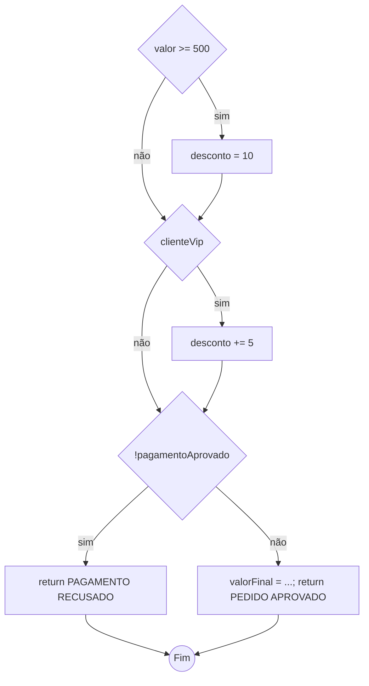
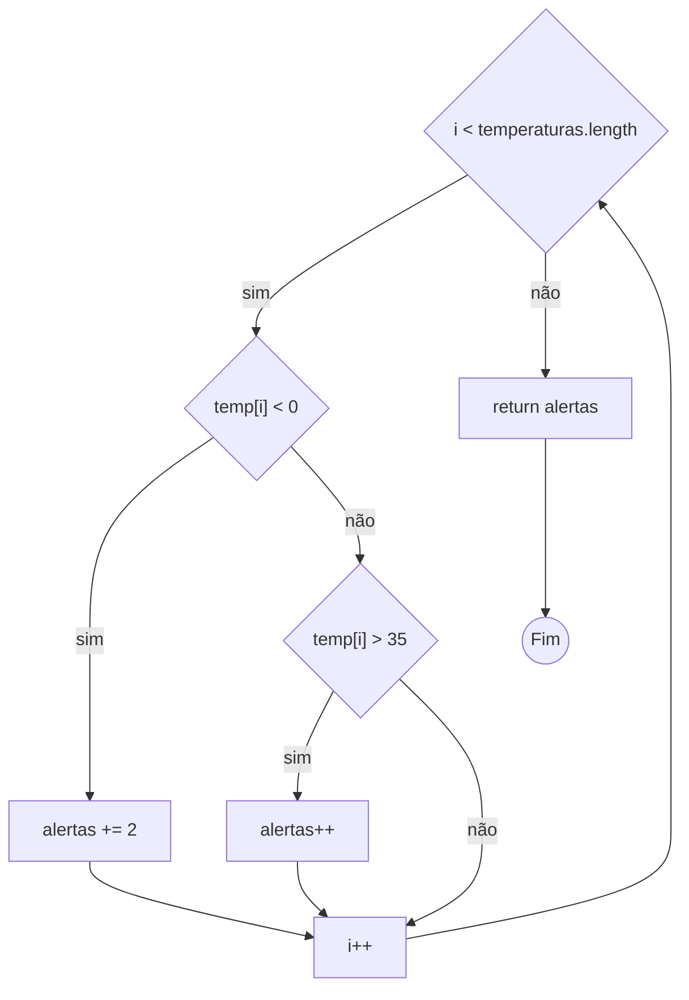

# Exercícios — Grafo de Fluxo de Controle

Vinicius Ramon Ferreira
20/09/2026

## Exercício 1 — Classificação de pedido

### Blocos básicos e decisões

O método tem três decisões, uma sequência atrás da outra (não são `&&`/`||` encadeados, são três `if` separados):

- D1: `valor >= 500`
- D2: `clienteVip`
- D3: `!pagamentoAprovado`

Nenhuma delas depende do resultado da anterior, então cada uma vira um nó de decisão simples, sem precisar quebrar em curto-circuito.

Blocos:

- B1: `desconto = 0;` seguido do teste `if (valor >= 500)` — como não tem nada entre a atribuição e o teste, viram o mesmo bloco.
- B2: `desconto = 10;`
- B3: teste `if (clienteVip)`
- B4: `desconto += 5;`
- B5: teste `if (!pagamentoAprovado)`
- B6: `return "PAGAMENTO RECUSADO";`
- B7: `valorFinal = ...; return "PEDIDO APROVADO: " + valorFinal;`

### Grafo

O terceiro `if` é o único com `return` dentro — isso corta o grafo em dois destinos finais em vez de deixar tudo convergir num só ponto antes da saída: quem entra em B6 nunca chega em B7, então o cálculo de `valorFinal` fica isolado do lado "pagamento recusado".

### Contagem

N = 8 (B1 a B7 + Fim)
E: B1→B2, B1→B3, B2→B3, B3→B4, B3→B5, B4→B5, B5→B6, B5→B7, B6→Fim, B7→Fim = 10

V(G) = E − N + 2 = 10 − 8 + 2 = **4**
V(G) = decisões + 1 = 3 + 1 = **4** ✓ bateu.

### Caminhos independentes

| Caminho | valor | clienteVip | pagamentoAprovado | Resultado |
| --- | --- | --- | --- | --- |
| 1 | 300 | false | true | PEDIDO APROVADO: 300.0 |
| 2 | 600 | false | true | PEDIDO APROVADO: 540.0 |
| 3 | 300 | true | true | PEDIDO APROVADO: 285.0 |
| 4 | 300 | false | false | PAGAMENTO RECUSADO |

O caminho 1 é o "tudo falso" (baseline), e cada um dos outros três inverte exatamente uma das três decisões em relação a ele.

### Discussão

Combinações possíveis entre as três condições: 2×2×2 = 8. A complexidade ciclomática é 4, bem menor que 8 — V(G) conta quantos caminhos *independentes* (em termos de arestas) bastam pra gerar qualquer caminho do grafo por combinação linear, não quantas combinações de entrada existem. Como as três decisões não interagem entre si (nenhuma delas muda o que a próxima vai testar), várias das 8 combinações acabam caindo no mesmo caminho estrutural — por exemplo, `(600,true,true)` e `(300,true,true)` passam pelos mesmos blocos, só o valor final muda.

O `return` dentro do terceiro `if` faz o grafo ter dois nós de saída ao invés de um só: sem ele, as três decisões convergiriam pra um único bloco final antes do fim do método. Com ele, quem cai em "pagamento recusado" nunca alcança o bloco que calcula `valorFinal` — é fisicamente impossível calcular `valorFinal` com pagamento não aprovado, porque o grafo não tem nenhuma aresta de B6 pra B7.

## Exercício 2 — Análise de leituras de temperatura

### Blocos básicos e decisões

- D1: condição do `while (i < temperaturas.length)`
- D2: `if (temperaturas[i] < 0)`
- D3: `else if (temperaturas[i] > 35)`

Blocos:

- B1: teste do `while`
- B2: teste `if (temp[i] < 0)`
- B3: `alertas += 2;`
- B4: teste `else if (temp[i] > 35)`
- B5: `alertas++;`
- B6: `i++;` (todo mundo que passou pelo corpo do laço cai aqui antes de voltar pro B1)
- B7: `return alertas;`

### Grafo

### Contagem

N = 8 (B1 a B7 + Fim)
E: B1→B2, B1→B7, B2→B3, B2→B4, B3→B6, B4→B5, B4→B6, B5→B6, B6→B1, B7→Fim = 10

V(G) = E − N + 2 = 10 − 8 + 2 = **4**
V(G) = decisões + 1 = 3 + 1 = **4** ✓ bateu.

### Caminhos independentes

| Caminho | Vetor | Retorno |
| --- | --- | --- |
| 1 — sai do laço sem iterar | `[]` | 0 |
| 2 — temperatura negativa | `[-5]` | 2 |
| 3 — temperatura acima de 35 | `[40]` | 1 |
| 4 — temperatura entre 0 e 35 (inclusive) | `[20]` | 0 |

Testei também as duas fronteiras que a questão de discussão pede — `[0]` e `[35]` — e os dois caem no caminho 4 (retorno 0), confirmando que os limites `>= 0` e `<= 35` pertencem à faixa "sem alerta".

### Discussão

Um vetor com várias temperaturas passa pelo corpo do laço (B2 a B6) uma vez pra cada posição, então sim, repete partes do grafo — um vetor como `[-5, 40, 20]` percorre o caminho 2, depois o 3, depois o 4, na mesma execução (retorna 2+1+0=3, testei isso também). Não é um único caminho no sentido de McCabe; é a mesma sequência de nós visitada várias vezes.

A única entrada que sai do método sem acessar nenhuma posição do vetor é o vetor vazio — a condição do `while` já é falsa na primeira checagem, então `temperaturas[i]` nunca chega a ser lido.

Testar `0` e `35` avalia as fronteiras dos dois `if`: `0` é o limite inferior de "não é negativo" (a condição `< 0` já é falsa nele) e `35` é o limite superior de "não passou de 35" (a condição `> 35` é falsa nele também, porque é `>`, não `>=`). Os dois confirmam que a faixa "sem alerta" é fechada dos dois lados.

O `else if` precisa ser uma decisão nova porque só é avaliado quando o primeiro `if` foi falso — é um curto-circuito estrutural do próprio `if/else if`, igual a um `&&`: se `temp[i] < 0` for verdadeiro, `temp[i] > 35` nunca é testado. Tratar os dois como uma decisão só esconderia esse fato e faria o grafo contar errado quantos caminhos distintos existem dentro do laço.

O retorno do laço (aresta B6 → B1) precisa aparecer no CFG porque é o que faz o `while` ser, de fato, um laço: sem essa aresta o grafo não teria ciclo nenhum, e não daria pra representar "a mesma decisão sendo repetida pra cada posição do vetor" nem calcular corretamente o V(G) — é essa aresta extra (comparado a uma sequência linear de blocos) que gera o "+1" na complexidade ciclomática do laço.
