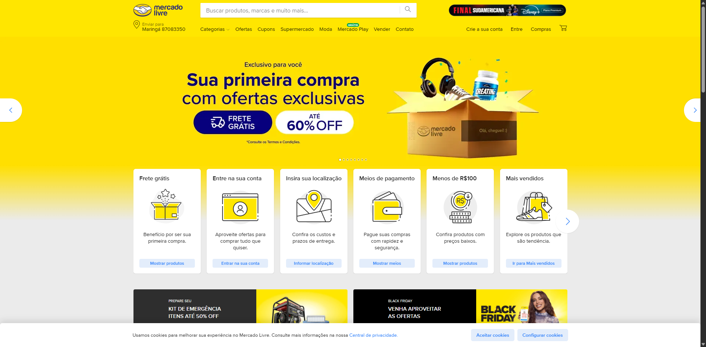
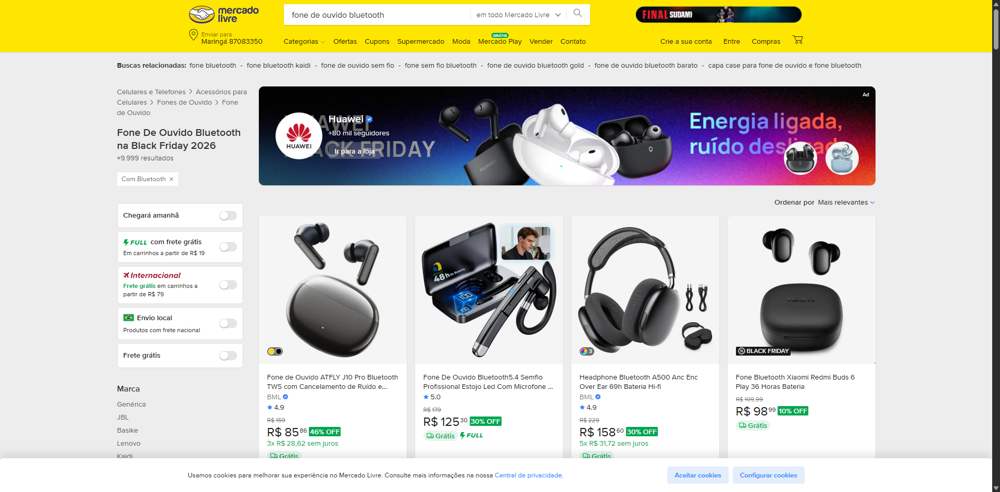
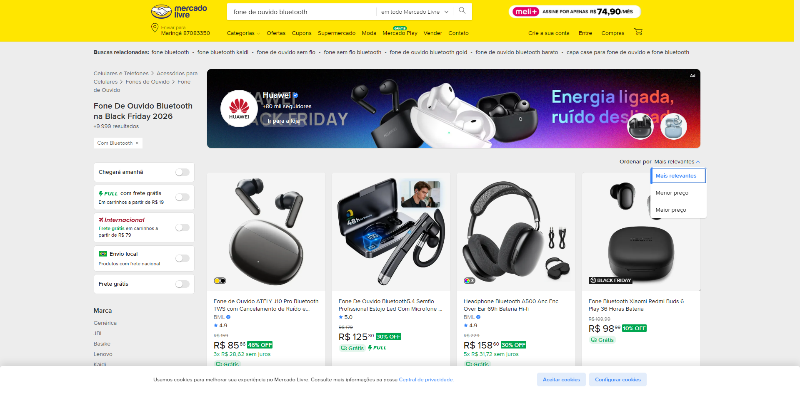
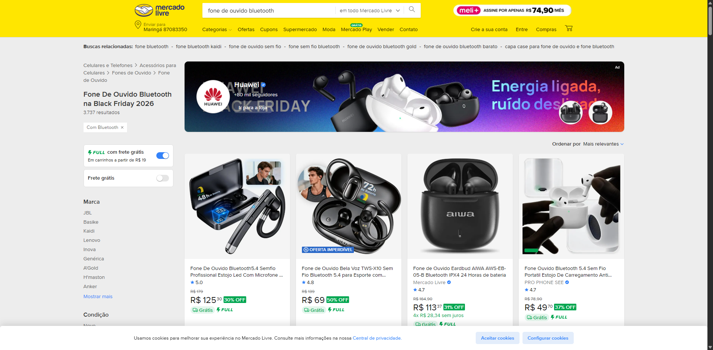
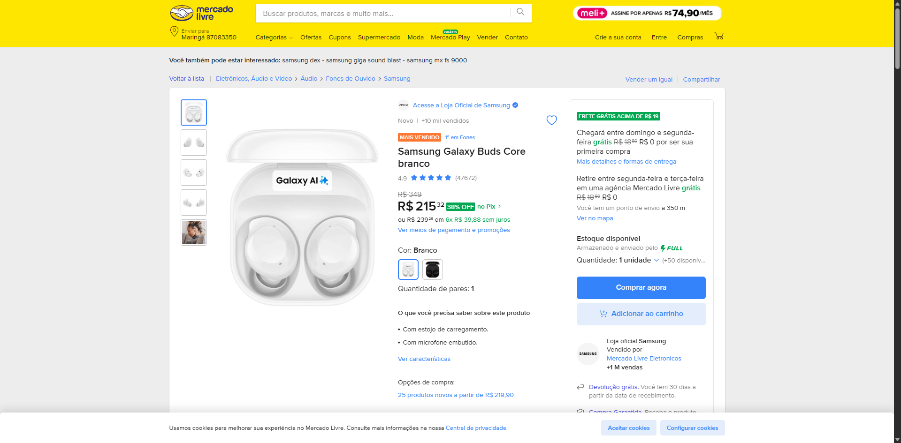
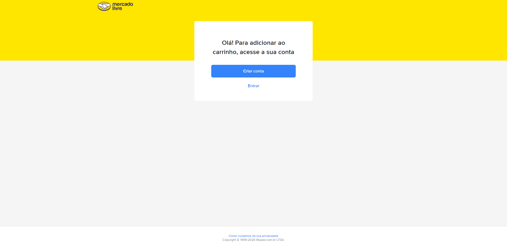
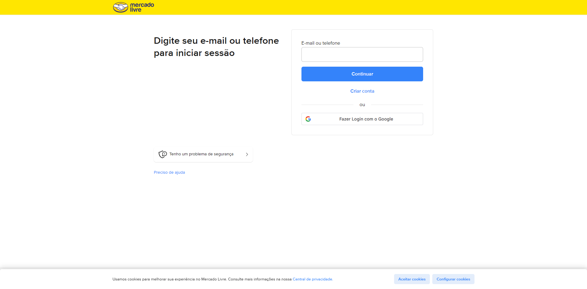
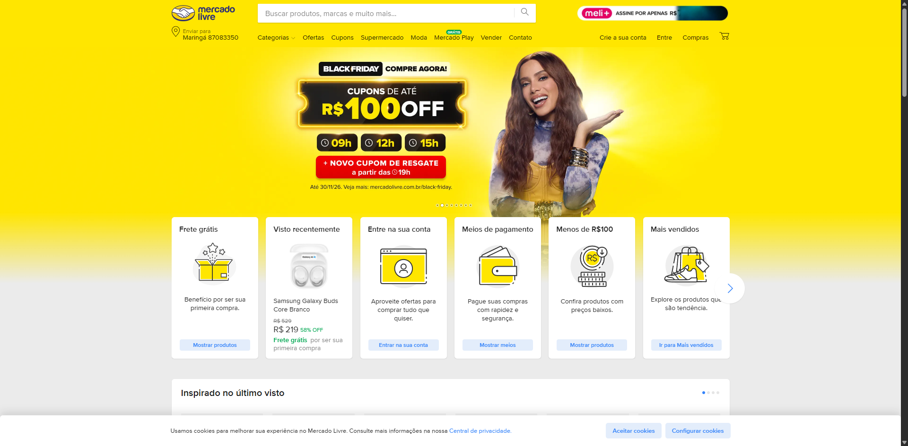

# Semana 14 — Teste de Usuário Final (Usabilidade / IHC)

**Aluno:** Vinicius Ramon Ferreira  
**Disciplina:** Teste e Qualidade de Software  
**Data de Execução:** 20/11/2026 (`06:17` – `06:23` GMT-3)  
**Sistema Avaliado:** [Mercado Livre Brasil](https://www.mercadolivre.com.br)  
**Ambiente de Teste:** Google Chrome Desktop (`1920x945`), sessão de usuário visitante (não autenticado), CEP detectado automaticamente (`Maringá - PR, 87083-350`), sem entrada de credenciais ou dados de pagamento.

---

## 1. Objetivo e Cenário de Uso

- **Objetivo:** Avaliar a facilidade de uso, eficiência e clareza da interface durante as etapas de busca, filtragem, comparação e simulação de compra no Mercado Livre, aplicando conceitos de IHC e testes de usabilidade conforme o roteiro em [TESTE USUARIO FINAL.pdf](./TESTE%20USUARIO%20FINAL.pdf).
- **Cenário de Uso:** Buscar um **fone de ouvido sem fio (Bluetooth)** para uso diário com entrega **Full** e boa avaliação, comparar opções disponíveis e simular a compra até o carrinho/início do checkout (sem concluir o pagamento), retornando à página inicial ao final.

---

## 2. Planilha de Observação (Execução Real)

*(Versão tabular exportável disponível em [planilha_observacao.csv](./planilha_observacao.csv).)*

| # | Tarefa | Tempo (s) | Sucesso (S/N) | Erros / Fricções | Observações |
|---|---|---:|:---:|---:|---|
| 1 | Acessar site (`mercadolivre.com.br`) | 3 | **S** | 1 | Carregamento rápido e sem CAPTCHA. Banner fixo de cookies no rodapé (`Aceitar cookies` / `Configurar cookies`) e alta densidade promocional (Black Friday). Labels de acessibilidade do carrossel vazando espanhol (`Carrusel`, `Siguiente`). |
| 2 | Buscar produto (`"fone de ouvido Bluetooth"`) | 5 | **S** | 0 | Campo de busca centralizado e muito visível (`Digite o que você quer encontrar`). Retornou `+9.999 resultados`, breadcrumbs corretos e chip automático `"Com Bluetooth"`. |
| 3 | Aplicar filtros (`Entrega Full` + `Melhores avaliados`) | 35 | **Parcial** *(Full: S / Avaliados: N)* | 3 | Filtro **Full** muito acessível no topo da lateral esquerda (`3.737 resultados`). **Gargalo crítico:** o menu `Ordenar por` oferece apenas 3 opções (`Mais relevantes`, `Menor preço`, `Maior preço`), **sem opção "Melhores avaliados"**; nenhuma das 16 seções laterais possui filtro por nota/estrelas do produto (apenas `Melhores vendedores`). |
| 4 | Comparar opções e abrir detalhes | 21 | **S** | 2 | Os 4 primeiros itens são anúncios (`Patrocinado`). Os cards mostram a nota média (`4.8`, `4.9`, `5.0`), mas **omitem a quantidade de avaliações**. Escolhido o **Samsung Galaxy Buds Core branco** (`4.9 ★`, `47.672 opiniões`, `1º em Fones`, `Enviado pelo FULL`). |
| 5 | Adicionar ao carrinho | 5 | **N** *(bloqueado sem login)* | 2 | **Ausência de carrinho para visitante (Guest Cart):** clicar em `Adicionar ao carrinho` redirecionou imediatamente para a tela `"Olá! Para adicionar ao carrinho, acesse a sua conta"` (`Criar conta` / `Entrar`), mantendo `0` itens no carrinho e sem botão explícito de voltar à página do produto. |
| 6 | Simular compra (sem concluir pagamento) | 9 | **Parcial / S** *(parou no login)* | 2 | Ao voltar à PDP e clicar em `Comprar agora`, o fluxo pulou a tela intermediária e foi direto ao formulário de login (`"Digite seu e-mail ou telefone para iniciar sessão"` com Google SSO e redirecionamento para `/gz/checkout/buy`). Evidencia **inconsistência entre os dois CTAs** e ausência de guest checkout. Execução encerrada antes de login/pagamento. |
| 7 | Retornar à tela inicial | 2 | **S** | 1 | Um clique no logotipo `Mercado Livre Brasil` retornou instantaneamente à Home. A seção `"Visto recentemente"` exibiu o fone visitado, porém com **preço divergente** (`R$ 219` / `58% OFF` de `R$ 529` vs `R$ 215,32 no Pix` / `38% OFF` de `R$ 349` na PDP Full) e textos alternativos em espanhol (`Antes: 529 reales`, `Ahora: 219 reales`). |
| — | **Total** | **80 s (1m 20s)** | **4 S / 2 Parciais / 1 N** | **11 fricções** | Fluxo concluído bem abaixo do tempo limite de 4 minutos, porém com dois bloqueios estruturais relevantes para usuários não autenticados. |

---

## 3. Dados Coletados e Avaliação dos Critérios de Sucesso

| Métrica | Resultado Obtido | Critério Definido no Roteiro | Avaliação |
|---|---|---|---|
| **Tempo de execução** | **80 segundos (1 min 20 s)** | Tempo médio até **4 minutos (240 s)** | **Atendido** (consumiu 33% do tempo máximo previsto; quase metade do tempo total foi gasta tentando localizar o filtro/ordenação inexistente de "Melhores avaliados"). |
| **Taxa de sucesso (adição ao carrinho)** | **0% em sessão visitante** (bloqueado por login obrigatório) | **90% dos usuários** devem conseguir adicionar o produto ao carrinho | **Não atendido para visitante não logado.** O botão é fácil de encontrar, mas a regra de negócio impede a conclusão da tarefa sem criação prévia de conta/login. |
| **Erros e fricções cometidos** | **11 fricções observadas** (3 em filtros, 2 em comparação, 2 em carrinho, 2 em compra, 1 na home, 1 no retorno) | Minimizar confusão nos filtros e perda de caminho | **Pontos de melhoria identificados**, especialmente na ausência de ordenação por avaliação e no bloqueio do carrinho sem login. |

---

## 4. Comparação de Produtos e Produto Selecionado

Após aplicar o filtro **Entrega Full** (`3.737 resultados`) e descartar os 4 anúncios patrocinados no topo da grade, foram comparadas 3 opções orgânicas com selo `Enviado pelo FULL` e `Frete Grátis`:

| Produto | Loja | Preço | Nota no Card | Entrega | Observação |
|---|---|---|---:|---|---|
| **JBL Wave Buds 2 Fit Preto** | Loja oficial JBL | R\$ 271,26 (`26% OFF` de R\$ 369) | 4.8 | Full / Grátis | Boa reputação de marca, preço mais elevado entre os três. |
| **Xiaomi Redmi Buds 6 Play Preto** | Loja oficial FAMILAR | R\$ 89,90 (`10% OFF` de R\$ 99,99) | 4.8 | Full / Grátis | Opção de entrada mais econômica. |
| **Samsung Galaxy Buds Core branco** *(Escolhido)* | Loja oficial Samsung / vendedor `eletro2u` | **R\$ 215,32 no Pix** (`38% OFF` de R\$ 349) ou R\$ 239,25 em 6x | **4.9** | **Full / Grátis** | Maior nota entre os comparados, líder de vendas e excelente custo-benefício. |

### Ficha do Produto Escolhido (PDP)
- **Nome:** `Samsung Galaxy Buds Core branco`
- **URL:** `https://www.mercadolivre.com.br/samsung-galaxy-buds-core-branco/p/MLB52039200?pdp_filters=shipping%3Afulfillment`
- **Avaliação:** **4.9 / 5.0** com **47.672 opiniões** | Selo **`MAIS VENDIDO — 1º em Fones`** (`+10 mil vendidos`)
- **Garantias e Entrega:** Enviado pelo **FULL**, `+50 disponíveis`, devolução grátis em 30 dias, Compra Garantida e 12 meses de garantia de fábrica.

---

## 5. Evidências Visuais da Execução

### Tarefa 1 — Acesso à página inicial

### Tarefa 2 — Busca por `"fone de ouvido Bluetooth"`

### Tarefa 3 — Menu `"Ordenar por"` (apenas 3 opções) e aplicação do filtro `Full`

### Tarefa 4 — Página de detalhes do produto escolhido (`Samsung Galaxy Buds Core branco`)

### Tarefa 5 — Tentativa de adicionar ao carrinho (parede de login obrigatória)

### Tarefa 6 — Simulação do início da compra (`Comprar agora` → tela de identificação)

### Tarefa 7 — Retorno à tela inicial (`Visto recentemente` com divergência de preço)

---

## 6. Avaliação de Usabilidade — Questionário SUS (System Usability Scale)

Aplicação das 10 afirmações padronizadas da escala SUS (`1 = Discordo totalmente` até `5 = Concordo totalmente`) com base na experiência real observada:

| # | Afirmação SUS | Nota (1–5) | Cálculo SUS | Pontos |
|---|---|---:|---|---:|
| 1 | Acho que gostaria de usar este sistema com frequência. | 4 | `nota - 1` | 3 |
| 2 | Achei o sistema desnecessariamente complexo. | 2 | `5 - nota` | 3 |
| 3 | Achei o sistema fácil de usar. | 4 | `nota - 1` | 3 |
| 4 | Acho que precisaria de ajuda técnica para conseguir usar o sistema. | 1 | `5 - nota` | 4 |
| 5 | Acho que as várias funções do sistema estão muito bem integradas. | 3 | `nota - 1` | 2 |
| 6 | Acho que o sistema apresenta muita inconsistência. | 3 | `5 - nota` | 2 |
| 7 | Imagino que a maioria das pessoas aprenderia a usar o sistema rapidamente. | 4 | `nota - 1` | 3 |
| 8 | Achei o sistema muito atrapalhado/pesado de usar. | 2 | `5 - nota` | 3 |
| 9 | Me senti muito confiante usando o sistema. | 3 | `nota - 1` | 2 |
| 10 | Precisei aprender muitas coisas novas antes de conseguir usar o sistema. | 1 | `5 - nota` | 4 |
| — | **Soma das contribuições** | — | — | **29** |

$$\text{Pontuação SUS} = 29 \times 2{,}5 = \mathbf{72{,}5}$$

- **Interpretação (Benchmark Bangor/Kortum/Miller):** A pontuação **72,5** posiciona a experiência na faixa **"Bom" (acima da média de mercado de 68,0)**, refletindo excelente eficiência na busca, na filtragem de entrega Full e na clareza da página de produto, mas penalizada diretamente pelos bloqueios de sessão visitante e limitações de ordenação/comparação.

---

## 7. Análise Heurística de IHC (Heurísticas de Nielsen) e Recomendações

| Achado Observado | Heurística de Nielsen Afetada | Severidade | Recomendação de Melhoria |
|---|---|---|---|
| Ausência de ordenação por `"Melhores avaliados"` e de filtro por estrelas na barra lateral | **Flexibilidade e eficiência de uso** / **Correspondência entre o sistema e o mundo real** | Alta | Incluir `"Melhores avaliados"` no seletor `Ordenar por` e filtro de faixa de estrelas (`4★ ou mais`) na barra lateral. |
| Exigência de login imediato ao clicar em `"Adicionar ao carrinho"` (sem *Guest Cart*) e falta de botão "Voltar" | **Controle e liberdade do usuário** / **Consistência e padrões** | Alta | Permitir carrinho temporário para visitantes (persistido em cookie/localStorage) e solicitar autenticação apenas no fechamento do pedido. |
| Fluxos diferentes entre `Adicionar ao carrinho` (tela intermediária sem Google SSO) e `Comprar agora` (login direto com Google SSO) | **Consistência e padrões** | Média | Unificar o fluxo de autenticação entre os dois CTAs da caixa de compra. |
| Cards de resultado exibem nota (`4.9`) sem quantidade de avaliações + 4 primeiros resultados são anúncios patrocinados | **Visibilidade do status do sistema** / **Estética e design minimalista** | Média | Exibir o total de opiniões ao lado da nota nos cards (ex.: `4.9 (47 mil)`) e diferenciar visualmente de forma mais clara itens patrocinados dos orgânicos. |
| Preço divergente no bloco `"Visto recentemente"` na Home (`R$ 219` vs `R$ 215,32 no Pix` na PDP Full) | **Consistência e padrões** | Média | Preservar o contexto da oferta visualizada (ou explicitar o desconto Pix / filtro Full) nos cards de histórico recente. |
| Labels de acessibilidade em espanhol na versão `pt-BR` (`Carrusel`, `Siguiente`, `Botón 1 de 2`, `reales`) | **Correspondência entre o sistema e o mundo real** (Acessibilidade / i18n) | Baixa | Corrigir strings `aria-label` / `aria-roledescription` para português brasileiro visando usuários de leitores de tela. |
